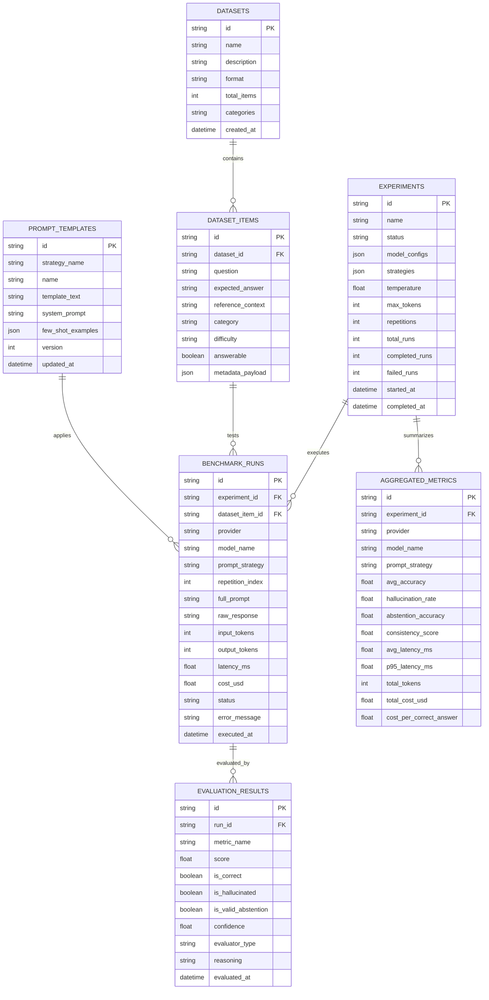
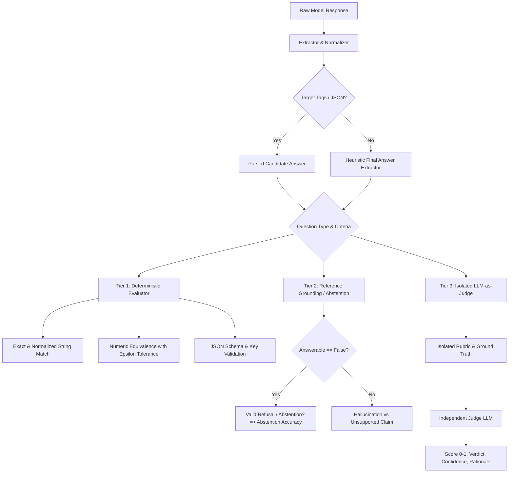

# PromptBench AI — System Architecture & Specification

## 1. Problem Statement & System Objectives

Modern enterprise and AI engineering workflows struggle with systematic prompt validation:
- **Intuition-driven engineering:** Developers frequently alter prompts or upgrade LLM model checkpoints without standardized baseline testing.
- **Unmeasured hallucination & abstention:** High accuracy on answerable questions often masks a model's propensity to fabricate answers when context is missing or questions are unanswerable.
- **Cost vs. Performance trade-offs:** Complex prompt strategies (such as multi-path Chain-of-Thought or Self-Consistency) increase token consumption and latency by 3x–10x, often with marginal accuracy gains.
- **Infrastructure complexity:** Existing evaluation frameworks often mandate multi-step vector indexes, external cloud databases, or heavyweight dependencies that complicate local deployment and reproducible experimentation.

**PromptBench AI** is an open, reproducible, self-contained benchmarking platform built with a modern Next.js frontend, an asynchronous FastAPI backend, and local SQLite storage. It enables side-by-side evaluation of 8 standard prompt engineering strategies across top frontier and local LLMs (OpenAI, Gemini, Anthropic, Ollama, plus a built-in Mock/Sandbox provider).

---

## 2. Technical Architecture & Component Topology

```mermaid
graph TD
    subgraph Frontend ["Frontend (Next.js 14 App Router / TypeScript)"]
        UI_Dash[Dashboard & KPI Metrics]
        UI_Lab[Prompt Engineering Lab]
        UI_Bench[Benchmark Configurator & Runner]
        UI_Data[Dataset Manager & Validator]
        UI_Model[Model & Provider Settings]
        UI_Analytics[Leaderboards & Recharts Analytics]
        SSE_Client[SSE Live Progress Listener]
    end

    subgraph Backend ["Backend (FastAPI / Python 3.11+)"]
        API_Gateway[FastAPI REST API & SSE Router]
        Auth_Sec[Secret Manager / Env Decryption]
        
        subgraph Core_Engines ["Core Engines"]
            Bench_Engine[Async Benchmark Execution Engine]
            Prompt_Engine[Prompt Strategy Synthesizer]
            Eval_Engine[Multi-Tier Evaluation Engine]
        end
        
        subgraph Provider_Layer ["Extensible Provider Adapters"]
            OpenAI_Adapt[OpenAI Adapter]
            Gemini_Adapt[Gemini Adapter]
            Anthropic_Adapt[Anthropic Adapter]
            Ollama_Adapt[Ollama Local Adapter]
            Mock_Adapt[Mock/Sandbox Adapter]
        end
        
        subgraph Evaluators ["Evaluation Modules"]
            Det_Eval[Deterministic Matcher (Exact/Norm/Numeric/JSON)]
            Ref_Eval[Reference Grounding & Hallucination Detector]
            Abst_Eval[Abstention & Refusal Classifier]
            Judge_Eval[LLM-as-Judge Evaluator (Isolated Rubric)]
        end
    end

    subgraph Storage ["Persistent Storage Layer"]
        DB[(SQLite via SQLAlchemy / aiosqlite)]
        FileSystem[Local File Storage: Datasets / JSONL / CSV / Reports]
    end

    UI_Dash --> API_Gateway
    UI_Lab --> API_Gateway
    UI_Bench --> API_Gateway
    UI_Data --> API_Gateway
    UI_Model --> API_Gateway
    UI_Analytics --> API_Gateway
    SSE_Client <.. API_Gateway

    API_Gateway --> Bench_Engine
    API_Gateway --> Prompt_Engine
    API_Gateway --> Eval_Engine
    API_Gateway --> DB

    Bench_Engine --> Provider_Layer
    Bench_Engine --> Prompt_Engine
    Bench_Engine --> Eval_Engine
    
    Eval_Engine --> Evaluators
    Bench_Engine --> DB
    API_Gateway --> FileSystem
```

---

## 3. Storage Architecture & Database Schemas (SQLite)

We use SQLite via SQLAlchemy 2.0 with async support (`aiosqlite`) for zero-overhead local deployment, foreign key integrity, and WAL (Write-Ahead Logging) mode for concurrent reader/writer operations.

### Schema Entity Relationship Diagram



---

## 4. Backend API Endpoints (FastAPI)

All endpoints conform to OpenAPI 3.1 standards with strict Pydantic schemas:

| Method | Endpoint | Description |
|---|---|---|
| `GET` | `/api/v1/health` | Healthcheck and active provider status |
| `GET` | `/api/v1/dashboard/stats` | Global summary stats (experiments, models, strategies, avg accuracy, hallucination) |
| `GET` | `/api/v1/dashboard/recent` | Recent benchmark activities and performance cards |
| `GET` | `/api/v1/providers` | List available LLM providers and configuration status |
| `POST` | `/api/v1/providers/test` | Test connectivity & auth for a provider/model |
| `GET` | `/api/v1/providers/ollama/models` | Auto-discover locally installed Ollama models |
| `POST` | `/api/v1/providers/configure` | Save provider configuration (in-memory/encrypted `.env`) |
| `GET` | `/api/v1/strategies` | List 8 core prompt strategies with metadata & parameters |
| `GET` | `/api/v1/strategies/{strategy_name}/templates` | Retrieve customizable prompt templates |
| `POST` | `/api/v1/strategies/preview` | Preview formatted prompt given a question & strategy |
| `GET` | `/api/v1/datasets` | List all datasets with item counts and category distributions |
| `POST` | `/api/v1/datasets/upload` | Upload CSV, JSON, or JSONL dataset with schema validation |
| `POST` | `/api/v1/datasets/manual` | Create dataset and add items manually |
| `POST` | `/api/v1/datasets/seed` | Seed standard benchmark datasets (Math, Reasoning, Factuality, Hallucination/Abstention) |
| `GET` | `/api/v1/datasets/{dataset_id}` | Fetch dataset details and items (with pagination & search) |
| `DELETE` | `/api/v1/datasets/{dataset_id}` | Delete a dataset and associated items |
| `POST` | `/api/v1/benchmarks` | Create and launch a benchmark experiment |
| `GET` | `/api/v1/benchmarks` | List all benchmark experiments with filter/sort |
| `GET` | `/api/v1/benchmarks/{experiment_id}` | Get benchmark metadata, status, and config |
| `GET` | `/api/v1/benchmarks/{experiment_id}/stream` | Server-Sent Events (SSE) live progress stream |
| `POST` | `/api/v1/benchmarks/{experiment_id}/cancel` | Cancel an ongoing benchmark |
| `DELETE` | `/api/v1/benchmarks/{experiment_id}` | Delete benchmark and associated run records |
| `GET` | `/api/v1/results/{experiment_id}/summary` | Aggregated metrics and leaderboards for an experiment |
| `GET` | `/api/v1/results/{experiment_id}/runs` | Filterable, paginated individual run outputs and evaluation scores |
| `POST` | `/api/v1/results/compare` | Multi-experiment side-by-side comparative analysis |
| `GET` | `/api/v1/export/{experiment_id}/csv` | Export detailed benchmark runs as CSV |
| `GET` | `/api/v1/export/{experiment_id}/jsonl` | Export detailed benchmark runs as JSONL |
| `GET` | `/api/v1/export/{experiment_id}/report` | Generate comprehensive Markdown/HTML printable report |

---

## 5. Frontend Architecture & Page Structure

Built with **Next.js (App Router)**, **TypeScript**, and **Tailwind CSS**, with a developer-first dark/light aesthetic inspired by modern AI telemetry platforms:

```
frontend/
├── app/
│   ├── layout.tsx              # Root shell with Collapsible Sidebar & Header
│   ├── page.tsx                # Module 1: Executive Analytics Dashboard
│   ├── experiments/
│   │   ├── page.tsx            # Experiment list with filtering & status
│   │   └── [id]/
│   │       ├── page.tsx        # Experiment results, leaderboards, charts, run inspection
│   │       └── compare/page.tsx# Side-by-side run comparison
│   ├── benchmark/
│   │   └── new/page.tsx        # Module 5: Multi-step Benchmark Configurator & Live Runner
│   ├── laboratory/
│   │   └── page.tsx            # Module 3: Prompt Engineering Lab (live multi-strategy playground)
│   ├── models/
│   │   └── page.tsx            # Module 2: Model Management, Provider Keys, Connectivity Tests
│   ├── datasets/
│   │   ├── page.tsx            # Module 4: Dataset Manager (Upload, Create, Seed, Inspect)
│   │   └── [id]/page.tsx       # Dataset Item Table & Category/Difficulty Inspector
│   ├── analytics/
│   │   └── page.tsx            # Module 7: Global Analytics, Strategy & Model Leaderboards
│   └── settings/
│       └── page.tsx            # Provider API Keys, Evaluator settings, Defaults
├── components/
│   ├── ui/                     # Design system (Cards, Badges, Tables, Tabs, Dialogs, Inputs)
│   ├── charts/                 # Recharts components (Accuracy vs Cost, Latency Distribution, Radar)
│   ├── bench/                  # Benchmark execution progress bar, status chips
│   └── layout/                 # Sidebar, Navbar, ThemeToggle
└── lib/
    ├── api.ts                  # Typed Axios/Fetch client
    ├── types.ts                # TypeScript interfaces corresponding to backend Pydantic models
    └── hooks/                  # useBenchmarkStream, useTheme
```

---

## 6. Prompt Engineering Laboratory Strategies

PromptBench AI natively implements 8 standardized prompt strategies:

1. **Zero-Shot:** Direct task instruction without exemplars (`"Answer the following question directly and concisely: {question}"`).
2. **Few-Shot:** Dynamically injects $k$ curated exemplars of `(question, reasoning, expected_answer)` from the dataset domain.
3. **Role-Based Prompting:** Domain-specific persona framing (`"You are an expert mathematician and rigorous analytical scientist..."`).
4. **Chain-of-Thought (CoT):** Enforces explicit step-by-step reasoning steps before the final answer tag (`"Think through this step-by-step. Provide your reasoning inside <thought>...</thought> and your final answer inside <answer>...</answer>"`).
5. **Structured Output (JSON):** Enforces strict JSON schema output (`{"reasoning": "...", "final_answer": "...", "confidence": 0.0-1.0, "cannot_answer": false}`).
6. **Task Decomposition:** Deconstructs complex inquiries into sub-questions or sequential milestones before answering.
7. **Self-Consistency:** Generates $N$ parallel stochastic completions at `temperature > 0.6`, parses candidate answers, and conducts majority voting to identify the consensus answer and consistency variance.
8. **Context-Grounded Prompting:** Strict closed-world constraint against external hallucinations (`"Answer ONLY based on the provided reference context. If the context does not contain the answer, explicitly state 'INSUFFICIENT_CONTEXT'"`).

---

## 7. Evaluation Engine & Scoring Methodology

The evaluation engine adheres to strict scientific separation of concerns:



### Metrics Definitions
1. **Accuracy ($A$):** Ratio of runs where the final answer matches ground truth criteria.
2. **Hallucination Rate ($H$):** Percentage of runs where the model generates a fabricated claim, especially when `answerable == false` or when the claim contradicts the reference context.
3. **Abstention Accuracy ($AA$):** Accuracy specifically evaluated on unanswerable test cases, scoring whether the model correctly declined to answer without guessing.
4. **Consistency Score ($C$):** Variance / entropy across identical repetitions ($k \ge 3$) under identical prompt conditions.
5. **Latency (Avg & P95):** End-to-end network & generation time in milliseconds.
6. **Token Consumption & Cost:** Real input and output token counts tracked per model pricing matrix ($/1M tokens).
7. **Cost per Correct Answer ($CPCA$):** $\frac{\text{Total Cost of Experiment}}{\text{Count of Correct Responses}}$ — the ultimate ROI metric for enterprise prompt engineering.

---

## 8. Phased Implementation Roadmap

- **Phase 1: Architecture & Scaffolding**
  - Initialize directory structure (`frontend/`, `backend/`, `data/`).
  - Backend virtual environment, FastAPI setup, SQLite async configuration, Pydantic schemas.
  - Frontend Next.js App Router setup with Tailwind CSS, Lucide icons, Recharts.
- **Phase 2: Dashboard UI & Global Navigation**
  - Build responsive dark/light application shell, sidebar navigation, header, theme provider.
  - Implement Dashboard metrics cards, recent experiments list, and placeholder chart components.
- **Phase 3: Backend Core & Database Persistence**
  - Implement SQLAlchemy models and aiosqlite migration/creation script.
  - Implement REST CRUD endpoints for datasets, prompt templates, experiments, and benchmark runs.
- **Phase 4: Dataset Management**
  - Dataset upload handlers (CSV, JSON, JSONL).
  - Validation engine checking for schema compliance (`question`, `expected_answer`, `category`, `difficulty`, `answerable`).
  - Built-in dataset seeders (Arithmetic/Reasoning, Factual QA, Hallucination/Abstention, Coding/JSON).
  - Dataset inspection UI in frontend.
- **Phase 5: LLM Provider Integrations**
  - Create `BaseLLMProvider` abstract base class with unified `complete()` interface.
  - Implement adapters for OpenAI, Google Gemini, Anthropic, Ollama, and Mock/Sandbox provider.
  - Implement token counting and cost calculation models.
  - Backend provider connectivity testing endpoint & frontend Model Management UI.
- **Phase 6: Prompt Strategy Implementation**
  - Implement all 8 prompt engineering strategy formatters.
  - Implement Prompt Laboratory in frontend for interactive side-by-side prompt generation testing.
- **Phase 7: Benchmark Execution Engine**
  - Build async orchestrator with concurrency control (semaphore worker pool), retry logic, and cancellation.
  - Implement Server-Sent Events (SSE) `/api/v1/benchmarks/{id}/stream` for live progress updates.
  - Frontend "New Benchmark" configurator and live execution monitor.
- **Phase 8: Multi-Tier Evaluation Engine**
  - Implement deterministic evaluators (exact match, normalized match, numeric tolerance, JSON validation).
  - Implement abstention and hallucination detector.
  - Implement LLM-as-Judge evaluator with isolated rubric and explanation generation.
- **Phase 9: Analytics, Leaderboards & Reporting**
  - Model leaderboard and Prompt Strategy leaderboard.
  - Recharts visualizers (Accuracy vs. Cost Pareto frontier, Latency distribution, Hallucination rate comparison).
  - Export utilities: CSV, JSONL, and print-ready HTML/PDF benchmark report.
- **Phase 10: Testing, Verification & Dockerization**
  - Pytest unit tests for evaluators, prompt strategies, and provider adapters.
  - Dockerfile and `docker-compose.yml` for unified one-command local execution.
  - Comprehensive `README.md` with quickstart instructions and API documentation.
